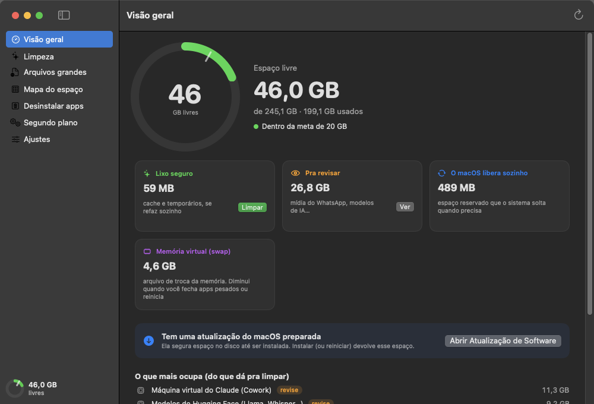
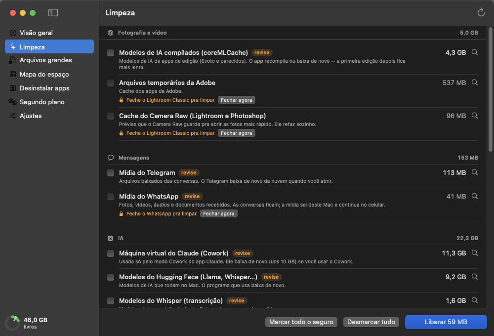

# Faxina 🧹

**Libera espaço no Mac e não deixa ele encher de novo sem você perceber.**

A Faxina mostra o que está ocupando o disco, inclusive o que o Finder esconde, e limpa com
segurança: cache e arquivos temporários saem com um clique; o que é seu (mídia do WhatsApp,
modelos de IA, apps) só sai se você marcar. Ela fica na barra de menus mostrando quantos GB
você tem livres e avisa quando o espaço cai abaixo da sua meta.

Feita para Macs com pouco disco (256 GB), por um fotógrafo que vivia com 5 GB livres por causa
de Lightroom, Evoto, DaVinci, WhatsApp e ferramentas de IA.



---

## Instalar em 3 passos

> Guia completo, com prints e solução de problemas: **[docs/INSTALAR.md](docs/INSTALAR.md)**

1. **Instale as ferramentas da Apple** (uma vez só). Abra o Terminal e cole:
   ```bash
   xcode-select --install
   ```
2. **Baixe e compile a Faxina:**
   ```bash
   git clone https://github.com/DKsix/faxina-mac.git
   cd faxina-mac
   ./build.sh instalar
   ```
3. **Abra:** `open /Applications/Faxina.app` — o ícone ✨ aparece na barra de menus com os GB livres.

Prefere não usar o Terminal? Baixe o app pronto na página de
[Releases](https://github.com/DKsix/faxina-mac/releases/latest) (veja o
[guia](docs/INSTALAR.md#jeito-2-baixar-o-app-pronto) pra liberar a abertura no macOS).

**Requisitos:** macOS 13 (Ventura) ou mais novo. Mac com chip Apple ou Intel.

---

## O que ela faz

| Tela | Pra que serve |
|---|---|
| **Visão geral** | Espaço livre, sua meta, o que o macOS libera sozinho, memória virtual (swap) e aviso de atualização do macOS que está segurando espaço |
| **Limpeza** | Tudo que dá pra limpar, separado por grupo (Fotografia e vídeo, Mensagens, IA, Navegadores, Apps, Programação, Sistema). Cache vem marcado; o que é seu vem desmarcado |
| **Arquivos grandes** | Acha vídeos, brutos, backups e arquivos esquecidos. Protege catálogos do Lightroom e bancos de dados de apps |
| **Mapa do espaço** | Pastas por tamanho, inclusive as ocultas, com explicação do que é cada uma |
| **Desinstalar apps** | Remove o app **e** os dados que ele espalha pela Biblioteca. Acha sobras de apps já apagados |
| **Segundo plano** | Tarefas que rodam sozinhas: quais estão com erro, quais reabrem apps, quais apontam pra programa que não existe mais |
| **Ajustes** | Meta de espaço livre, vigia, limpeza automática, abrir ao ligar o Mac, histórico |
| **Barra de menus** | GB livres (fica vermelho abaixo da meta) e botão pra limpar o lixo seguro |



O que ela encontra e limpa, item por item: **[docs/O-QUE-ELA-LIMPA.md](docs/O-QUE-ELA-LIMPA.md)**

---

## Segurança

- **Nada sai sem você ver.** Toda limpeza pede confirmação e diz se tem algo que não volta sozinho.
- **App aberto trava o item.** Cache do Lightroom só é limpo com o Lightroom fechado. O botão
  "Fechar agora" fecha como o Cmd+Q — se tiver algo sem salvar, o app pergunta antes.
- **Só mexe na sua pasta pessoal**, e nunca esvazia pastas-base (Documentos, Biblioteca, Downloads…).
- **Arquivos seus vão pra Lixeira** (arquivos grandes, instaladores, apps desinstalados). Cache sai de vez.
- **Histórico de tudo** que foi apagado em `~/Library/Logs/Faxina.log`.
- **Sem internet.** A Faxina não se conecta a nada, não tem conta, não coleta dados.

Como tudo isso funciona por dentro: **[docs/COMO-FUNCIONA.md](docs/COMO-FUNCIONA.md)**

---

## Documentação

| | |
|---|---|
| [INSTALAR.md](docs/INSTALAR.md) | Passo a passo de instalação, permissões, atualizar e desinstalar |
| [USAR.md](docs/USAR.md) | Como usar cada tela, na prática |
| [O-QUE-ELA-LIMPA.md](docs/O-QUE-ELA-LIMPA.md) | Catálogo completo: o que é cada item e o que acontece ao limpar |
| [PERGUNTAS.md](docs/PERGUNTAS.md) | "Apaguei 78 GB e só liberou 30", "o que é swap", "o que é espaço purgável"… |
| [COMO-FUNCIONA.md](docs/COMO-FUNCIONA.md) | Arquitetura, regras de segurança, vigia |
| [DESENVOLVER.md](docs/DESENVOLVER.md) | Estrutura do código, como adicionar um item ao catálogo, modos de teste |

---

## Créditos

- A separação entre "seguro" e "revise" e a lista de caches de apps Electron partiram do
  [Disco Livre](https://github.com/Willclaf/disco-livre) (MIT, Willian Carlos Lameu).
  Veja [THIRD_PARTY_NOTICES.md](THIRD_PARTY_NOTICES.md).
- As outras telas (arquivos grandes, mapa, desinstalador, segundo plano) foram escritas do zero,
  a partir do que apps como o CleanMyMac oferecem — sem usar código deles.

Licença [MIT](LICENSE).
